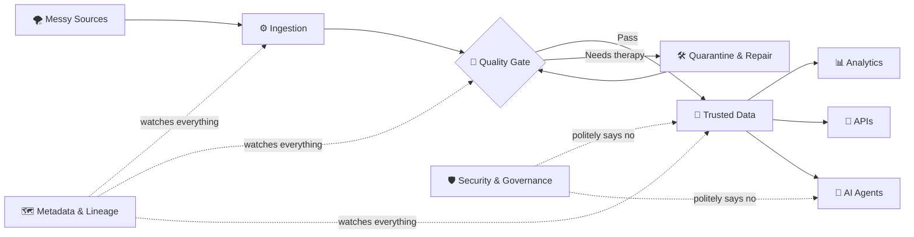

<!--
  GitHub Profile README for: https://github.com/xikander7
  To display this on your profile, place it in a public repository named exactly: xikander7
-->

<p align="center">
  
</p>

<p align="center">
  <a href="https://linkedin.com/in/xikander-shah">
    
  </a>
  <a href="mailto:syedxanshah@gmail.com">
    
  </a>
</p>

<p align="center">
  <a href="https://github.com/DenverCoder1/readme-typing-svg">
    
  </a>
</p>

---


## 👨‍💻 About Me

I am a **Senior AI Data Engineer** with **13+ years of experience** designing data integration, cloud, warehousing, MDM, governance and analytics solutions across **healthcare, automotive, retail and insurance**.

My career began with classic ETL and enterprise data warehouses. It has since evolved into building **cloud-native data platforms**, trusted **golden records**, scalable **lakehouse architectures**, and **AI-assisted engineering workflows**.

- 🔭 Currently modernizing healthcare data and MDM workloads on **GCP**
- 🧱 Building **BigQuery bronze, silver and gold layers** with trusted golden-record outputs
- ⚙️ Engineering pipelines with **Python, PySpark, SQL, Airflow, Dataflow and Dataproc**
- 🧠 Exploring **RAG, LangGraph, vector search, AI agents and multi-agent orchestration**
- 🛡️ Applying **data quality, lineage, reconciliation, PHI/PII protection and GenAI guardrails**
- ☁️ Comfortable across **GCP, Azure and AWS** — because one cloud was apparently too peaceful
- 💬 Ask me about **Data Engineering, Informatica, MDM, SQL, Cloud Migration, Lakehouse Architecture or GenAI for enterprise data**
- ⚡ Fun fact: **I have written code on four continents — because apparently latency should also be multicultural**

<br clear="right" />

> **I started by moving data between systems. Now I design systems that understand, govern and explain the data they move.**

---

## 🧭 What I Build

| Area | What it means in practice |
|---|---|
| **Cloud Data Platforms** | Scalable batch and streaming pipelines, lakehouse patterns, dimensional models and cost-aware warehouses |
| **Master Data Management** | Match/merge, survivorship, trust rules, deduplication, golden records and downstream publishing |
| **Data Quality & Governance** | Profiling, validation, lineage, metadata, reconciliation, auditability and secure data handling |
| **AI-Assisted Engineering** | RAG over technical knowledge, semantic search, code-generation workflows and specialized review agents |
| **Enterprise Integration** | APIs, event streams, cloud/on-prem connectivity and integration across legacy and modern platforms |

---

## 🎛️ Data Engineering Command Center

<p align="center">
  
</p>



<details>
<summary><b>🟢 Open live system status</b></summary>
<br />

| Component | Status | Engineer's Translation |
|---|---|---|
| Pipelines | 🟢 Operational | The scheduler and I are currently on speaking terms |
| Data Quality | 🟡 Suspicious by design | Trust is earned, especially by CSV files |
| Golden Records | 🟢 Surviving | Duplicates have entered conflict resolution |
| Metadata | 🟢 Watching | Nothing escapes lineage forever |
| AI Agents | 🟡 Supervised | Helpful, fast and absolutely not root users |
| Production | 🔵 Calm | Please do not say “quick change” near it |

</details>

<details>
<summary><b>🧩 Run the mental pipeline</b></summary>
<br />

```python
def build_trusted_data(raw_data):
    profiled = inspect_everything(raw_data)
    validated = reject_suspicious_assumptions(profiled)
    standardized = make_names_agree_on_reality(validated)
    golden_records = merge_duplicates_without_starting_a_family_feud(standardized)
    return publish_with_lineage(golden_records)
```

**Expected output:** useful data, explainable decisions and fewer mysterious spreadsheets.

</details>

> **My favorite architecture pattern:** simple enough to explain, strong enough to scale, and observable enough to confess when it is wrong.

---

## 🛠️ Technology Stack

<details open>
<summary><b>☁️ Cloud, Lakehouse & Data Platforms</b></summary>
<br />


</details>

<details open>
<summary><b>⚙️ Data Engineering, Programming & Orchestration</b></summary>
<br />

<p>
  
</p>


</details>

<details>
<summary><b>🧬 Integration, MDM, Quality & Governance</b></summary>
<br />


</details>

<details open>
<summary><b>🤖 GenAI, RAG & Agentic Data Engineering</b></summary>
<br />


</details>

<details>
<summary><b>🗄️ Databases, Warehouses & Analytics</b></summary>
<br />


</details>

---

## 🧠 Engineering Principles

```bash
$ cat engineering_philosophy.txt

Automate the repeatable.
Measure data quality instead of merely discussing it.
Treat lineage, observability and security as product features.
Design for the engineer who will be debugging this at 2:00 AM.
Never trust a file named final_final_v7_REAL_FIXED.csv.
```

> **A good data platform is boring in production, interesting in design and loudly honest when it fails.**

---

## 🌍 Beyond the Pipeline

When I am not designing data platforms, I am usually exploring:

- 🎧 Music production, DJing and the architecture of a properly timed drop
- ✈️ Travel, nature and finding new places before they become “hidden gems” on every reel
- 🧪 Emerging technology, AI tools and practical automation
- 🎮 Games, coding experiments and side-project rabbit holes

There is a surprising amount of overlap between data engineering and DJing:  
**timing matters, transitions matter, and nobody enjoys an unexpected crash.**

---

## 📊 GitHub Analytics

<p align="center">
  
  
</p>

<p align="center">
  
</p>

<p align="center">
  
</p>

---

## 🤝 Let’s Connect

I enjoy exchanging ideas about **modern data platforms, MDM, cloud migration, data governance and practical enterprise GenAI**.

<p align="center">
  <a href="https://linkedin.com/in/xikander-shah">
    
  </a>
  <a href="mailto:syedxanshah@gmail.com">
    
  </a>
</p>

<p align="center">
  <i>Building trusted data products — one pipeline, golden record and carefully supervised AI agent at a time.</i>
</p>

<p align="center">
  
</p>
