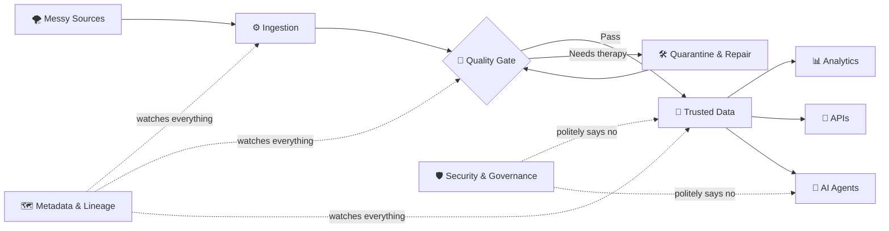

<!--
  Profile README for https://github.com/xikander7
  It shows on the profile when it sits in the public repo named exactly: xikander7
-->

<p align="center">
  
</p>

<p align="center">
  <a href="https://linkedin.com/in/xikander-shah"></a>
  <a href="mailto:syedxanshah@gmail.com"></a>
  
</p>

<p align="center">
  <a href="https://github.com/DenverCoder1/readme-typing-svg">
    
  </a>
</p>


## 👋 About me

I'm a senior AI data engineer, and I've been at it for 13+ years. Most of that time went into data integration, warehousing, MDM, governance and analytics for healthcare, automotive, retail and insurance companies.

I started out on classic ETL and big enterprise warehouses. These days I build cloud data platforms, lakehouses and golden records, and I use AI to take the tedious parts of engineering off my plate.

- 🔭 Moving healthcare data and MDM workloads onto GCP right now
- 🧱 Building BigQuery bronze, silver and gold layers that end in golden records
- ⚙️ Writing pipelines in Python, PySpark, SQL, Airflow, Dataflow and Dataproc
- 🧠 Playing with RAG, LangGraph, vector search and multi-agent setups
- 🛡️ Keeping it all honest with quality checks, lineage, reconciliation, PHI/PII protection and GenAI guardrails
- ☁️ At home on GCP, Azure and AWS, because one cloud was apparently too peaceful
- ⚡ I've written code on four continents. Latency deserves to be multicultural too.

Ask me about Informatica, MDM, SQL, cloud migrations, lakehouse design, or how to use GenAI on enterprise data without upsetting the compliance team.

<br clear="right" />

---

## 🎧 The set so far

My career plays a bit like a DJ set: it started slow and steady, then the tempo kept going up.

| Track | What was playing |
|:---:|---|
| `01` | Classic ETL and enterprise data warehouses |
| `02` | Master data management: match/merge, survivorship, golden records |
| `03` | Cloud data platforms and lakehouse architecture |
| `04` | AI-assisted engineering, RAG and agents |

<p align="center">
  
</p>

---

## 🧭 What I build

| Area | In practice |
|---|---|
| Cloud data platforms | Batch and streaming pipelines, lakehouses, dimensional models, warehouses that don't torch the budget |
| Master data management | Match/merge, survivorship and trust rules, dedup, golden records, publishing downstream |
| Data quality and governance | Profiling, validation, lineage, metadata, reconciliation, audit trails, safe handling of sensitive data |
| AI-assisted engineering | RAG over technical docs, semantic search, code generation, review agents with narrow jobs |
| Enterprise integration | APIs, event streams, cloud to on-prem links, old systems talking to new ones |

---

## 🎛️ Data engineering command center

<p align="center">
  
</p>



<details>
<summary><b>🟢 Click for live system status</b></summary>
<br />

| Component | Status | What that actually means |
|---|---|---|
| Pipelines | 🟢 Operational | The scheduler and I are on speaking terms this week |
| Data quality | 🟡 Suspicious by design | Trust is earned, especially by CSV files |
| Golden records | 🟢 Surviving | The duplicates are in couples counselling |
| Metadata | 🟢 Watching | Nothing escapes lineage forever |
| AI agents | 🟡 Supervised | Helpful, fast, and nowhere near root access |
| Production | 🔵 Calm | Please don't say "quick change" anywhere near it |

</details>

<details>
<summary><b>🧩 Click to run the mental pipeline</b></summary>
<br />

```python
def build_trusted_data(raw_data):
    profiled = inspect_everything(raw_data)
    validated = reject_suspicious_assumptions(profiled)
    standardized = make_names_agree_on_reality(validated)
    golden_records = merge_duplicates_without_starting_a_family_feud(standardized)
    return publish_with_lineage(golden_records)
```

```text
>>> build_trusted_data(load("final_final_v7_REAL_FIXED.csv"))
WARNING: filename failed vibe check
INFO: 4,812 duplicates found, 4,811 resolved, 1 still arguing
INFO: published with lineage. go home.
```

</details>

My favourite architecture is one I can explain on a whiteboard, that scales without drama, and that tells me when it's wrong.

---

## 🛠️ Tech stack

<details open>
<summary><b>☁️ Cloud, lakehouse and data platforms</b></summary>
<br />


</details>

<details open>
<summary><b>⚙️ Engineering, programming and orchestration</b></summary>
<br />

<p>
  
</p>


</details>

<details>
<summary><b>🧬 Integration, MDM, quality and governance</b></summary>
<br />


</details>

<details open>
<summary><b>🤖 GenAI, RAG and agents</b></summary>
<br />


</details>

<details>
<summary><b>🗄️ Databases, warehouses and analytics</b></summary>
<br />


</details>

---

## 🧠 House rules

```bash
$ cat engineering_philosophy.txt

Automate the repeatable.
Measure data quality instead of holding meetings about it.
Lineage, observability and security are features. Ship them.
Design for whoever is debugging this at 2:00 AM. It might be you.
Never trust a file named final_final_v7_REAL_FIXED.csv.
```

A good data platform is boring in production. When it breaks, it should say so loudly.

---

## 🌍 When I'm not on call

- 🎧 Producing music and DJing, mostly so I can obsess over a properly timed drop
- ✈️ Travelling and finding places before they turn into "hidden gems" on every reel
- 🧪 Trying new AI tools and automating things that probably didn't need automating
- 🎮 Games, coding experiments, and side projects that started as "just a quick look"

DJing and data engineering overlap more than you'd expect. Timing matters, transitions matter, and nobody enjoys an unexpected crash.

---

## 📊 GitHub stats

<p align="center">
  
  
</p>

<p align="center">
  
</p>

<p align="center">
  <picture>
    <source media="(prefers-color-scheme: dark)" srcset="https://raw.githubusercontent.com/xikander7/xikander7/output/github-snake-dark.svg" />
    <source media="(prefers-color-scheme: light)" srcset="https://raw.githubusercontent.com/xikander7/xikander7/output/github-snake.svg" />
    
  </picture>
</p>

---

## 🤝 Say hi

I like talking about modern data platforms, MDM, cloud migration, data governance, and GenAI that works in a real enterprise. If any of that is on your mind, send me a message.

<p align="center">
  <a href="https://linkedin.com/in/xikander-shah"></a>
  <a href="mailto:syedxanshah@gmail.com"></a>
</p>

<p align="center">
  
</p>

<p align="center">
  
</p>
